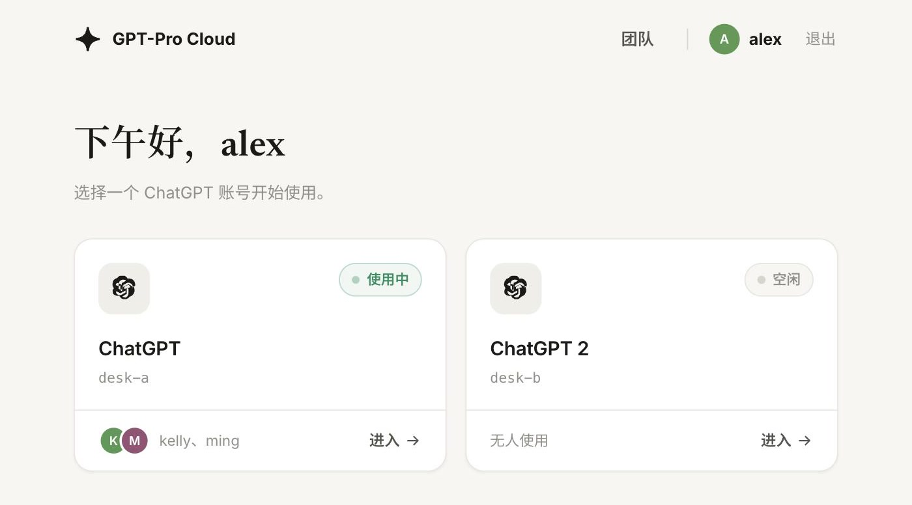

<div align="center">


# GPT-Pro Cloud — 一个 Pro 席位，团队设备通用

[](docker-compose.yml)
[](gateway/)
[](docker/)
[](https://kasmweb.com/kasmvnc)
[](Deploy.md)
[](LICENSE)

[English](README.md) | **简体中文**

</div>

---

GPT-Pro Cloud 是一套 Docker 网关加浏览器桌面，把已登录的 ChatGPT 会话跑在你自己的机器上。它面向需要一个 Pro 席位随处可达的个人和小团队：无需安装客户端，也不必再登录一次。

> **免责声明** —— 多人共用 ChatGPT 账号可能违反 OpenAI 的条款与政策。本仓库只提供自托管技术方案；是否使用、如何使用及一切后果由使用者自行承担，与本仓库无关。



每个账号独占一个带持久化 profile 的 Chromium。一个网关提供登录、账号选择、成员管理和远程桌面——全部在浏览器里完成。

每个账号**同一时间只给一个人用**，这个人独占一台 VNC 桌面。多人同时用一个账号（分屏席位）已关闭，面板里没有开关。

## 安装

运行环境：Docker Compose（Linux 服务器；macOS / Windows 用 Docker Desktop），每个账号约 1 GB 内存。

仓库是公开的。`./scripts/up.sh` **拉取**已发布的 GHCR 镜像（`ghcr.io/jingxuankang/gpt-pro-cloud-gateway:latest` 与 `ghcr.io/jingxuankang/gpt-pro-cloud-desktop:latest`）再启动，不会在你的机器上 `--build`。

```bash
git clone https://github.com/JingxuanKang/GPT-Pro-Cloud.git
cd GPT-Pro-Cloud
cp .env.example .env
./scripts/up.sh
```

或者只拉取 compose，再 pull 同一套公开镜像：

```bash
mkdir gpt-pro-cloud && cd gpt-pro-cloud
curl -fsSLO https://raw.githubusercontent.com/JingxuanKang/GPT-Pro-Cloud/main/docker-compose.yml
curl -fsSLo .env.example https://raw.githubusercontent.com/JingxuanKang/GPT-Pro-Cloud/main/.env.example
cp .env.example .env
docker compose pull && docker compose up -d
```

若 pull 失败（镜像尚未发布），本地构建用 `docker compose up -d --build`，或等 `main` 上的发布工作流跑完。

内网访问走局域网或 Tailscale 这类 VPN（明文 HTTP）。公网访问用 Cloudflare Tunnel，且必须先建好管理员——见[公网访问](#公网访问)。

## 快速开始

打开 `http://127.0.0.1:36090`（或局域网 / VPN 地址），首次访问会引导你创建管理员账号（也可以在 `.env` 里用 `AUTH_PASSWORD` 预设，适合自动化部署）。然后逐个打开账号卡片，在桌面里登录 ChatGPT——这一步要你自己完成，没有自动化。profile 跨重启保留，所以每个账号只需要做这一次。

之后同一内网里的任何设备打开同一个地址，进去就是已登录的会话。开公网隧道之前，先在本机或局域网建好管理员——否则陌生人打开公网地址就能抢注。

## 公网访问

公网入口是 Cloudflare Tunnel（HTTPS）。管理员必须已经存在（向导或 `AUTH_PASSWORD`），再开隧道。打开公网 URL 必须是登录页，不能是首次访问向导。

`.env` 里设 `BIND_ADDR=127.0.0.1`，避免面板同时以明文 HTTP 挂在公网网卡上，然后：

```bash
# 临时域名，不需要自己的域名
cloudflared tunnel --url http://127.0.0.1:36090
```

把打印出的 `https://` 地址发出去。部署者用已建好的管理员登录；成员用「管理」页创建的网关用户名/密码，不是 ChatGPT 密码。

要固定主机名，把 named tunnel 指到同一个本地端口（需要 Cloudflare 上有域名）。

## 添加账号

一个 ChatGPT 账号对应一个桌面容器。管理员在首页点 **添加 ChatGPT 账号**、起个名字，就会出现新卡片。打开后登录一次 ChatGPT，和 a / b 一样。

网关通过 Docker Engine API 克隆 `desktop-a` 的镜像，接到同一 compose 网络（DNS `desktop-<id>`，卷 `./data/<id>:/config`）。额外账号写在 `data-panel/users.json`，容器 `restart: unless-stopped`，网关重启后不必改 `INSTANCES` 或 `docker-compose.yml`。

一次宿主机配置：`docker-compose.yml` 把 `/var/run/docker.sock` 挂进 gateway。拉下这段改动后执行一次 `docker compose up -d` 让挂载生效。之后加号是面板操作，不要再 SSH 去复制 compose 服务。

`INSTANCES` 和 `desktop-a` / `desktop-b` 仍是内置席位，不要删；新账号以 `desktop-a` 为模板克隆。

Cloud / CI 虚拟机往往不跑桌面镜像，无法证明 Chromium 是活的。请在真实 Docker 宿主机（phoenix）上验证：面板里加一个账号、`docker ps` 能看到 `gpt-pro-cloud-<id>`、打开卡片并完成 ChatGPT 登录。

## 成员与权限

成员在「管理」页维护（仅管理员可见）：账号与成员都是卡片，每张卡自含操作。

| 目标 | 操作 |
| --- | --- |
| 新增成员 | 邀请后指定其可打开的账号 |
| 重置凭证 | 重置该成员密码，其会话同时失效 |
| 收回权限 | 停用或删除成员，在线会话立即断开 |
| 查看占用 | 账号卡片显示谁正在使用 |
| 断开席位 | 在占用中的账号卡片上点「断开」，撤掉对方的登录和 VNC 席位。容器还在。对方需重新登录。成员还在 |
| 删除额外账号 | 在面板添加的卡片上点「删除」，拆除容器并清掉 `./data/<id>`，再添加是干净的。内置 a / b 不能删 |

密码以逐用户加盐的 scrypt 哈希存储。登录按 `ip|用户名` 限流（15 分钟 10 次），会话跨重启保留。

## 剪贴板与文件

剪贴板在本机和桌面之间双向生效，文字和截图都可以（gpc-clipd / xclip）。

要附加文件，点桌面顶栏的「上传」或桌面里 ChatGPT 的回形针，在你自己的电脑上选文件；也可以把文件拖到桌面上。网关经桌面的调试口把文件交给 ChatGPT 的文件选择框。调试口只监听容器回环，转发器只接受 gateway。单次上传上限 12 MB。

生成的图片不一样：ChatGPT 自己的「复制」写在远端浏览器里，而 noVNC 只传文字，图片经常到不了本机。页面会留下这张图和图片分享链接（`chatgpt.com/share/…`、`chatgpt.com/s/…`）。画面下方会出现「复制到本机」和「下载」；浏览器如果拦住图片剪贴板，下载仍然把文件存到本机。顶栏「取图片」会取出对话里最新的一张生成图。

## 中文输入与下载

拼音在你自己的电脑上组字。平时打开的是 VNC 画面：顶栏有「中文」，点一下就在本机组字；也可以直接在画面里打，组字进画面上的输入区。确认后的汉字经 CDP `Input.imeSetComposition` / `Input.insertText` 写进桌面里已经点中的输入框，不再把每个汉字做成 X11 keysym（那张表装满后就再也打不出新的字）。

在对话里保存或下载的图片，会先落到桌面容器的 `/config/gpc-downloads`，网关再把它交给**你正在用的浏览器**下载到本机。顶栏「下载」会列出这次会话里保存过的文件：浏览器拦住自动下载时，从这里再取一次。

## 分享

在页面里点 ChatGPT 自带的 Share 并复制。链接经剪贴板链路落到你本机。

用同一个账号的成员看到同一份对话历史。网关不按成员建项目。页面协助（网关代点分享、按成员建仅项目内记忆的项目、项目锁定）属于分屏席位，随分屏席位一起关闭。

## 配置

全部配置在 `.env`，带注释的 [`.env.example`](.env.example) 就是参考。

| 配置项 | 作用 |
| --- | --- |
| `AUTH_PASSWORD` | 可选：预设管理员密码，留空走首次访问向导 |
| `INSTANCES` | compose 内置席位（`a,b`）。额外账号在面板里添加 |
| `TAB_SEATS_MAX` | 每个账号的分屏席位上限（默认 `3`，范围 1–8）。分屏席位关闭期间不生效 |
| `BIND_ADDR` | 网关监听地址；走隧道时填 `127.0.0.1`，内网则填局域网或 VPN 地址 |
| `PROXY_URL_A`、`PROXY_URL_B` | 按账号出口代理的默认值；「设置」页里逐行保存或「全部应用」优先且立即生效 |
| `PROXY_URL` | 所有账号共用的默认代理 |

代理只在服务器无法直连 ChatGPT 时需要（例如部署在中国大陆）；海外机器留空即可。前置条件是一个服务器可达的 `http://` / `https://` / `socks5://` 端点：宿主机上跑的代理客户端直接填 `http://127.0.0.1:7890` 这类回环地址，会自动改写为容器可达。

「设置」页的「全部应用」会把同一个地址写到每个 ChatGPT 账号，并走与逐行保存相同的即时下发（clipd / `--proxy-server`，浏览器会重启）。保存过的地址会留在上方，点一下即可再用，不用重新输入。

## 一个账号一个人

一个 ChatGPT 账号是一台桌面容器、一份 Chromium profile（`--user-data-dir=/config/chromium`）。

- 第一个打开账号的人独占 KasmVNC 桌面。
- 第二个人会被拒绝（`409 CDP_OFF`，提示「该账号正在使用中」），直到第一个人离开或管理员点「断开」。
- 分屏席位已关闭。`lib/seats.mjs` 的代码还在，但 `deskCdpOn()` 恒为 false，API 收到 `cdp: true` 会回「多人分屏暂未开放」。

## 架构

```
浏览器 ──▶ gateway (:36090) ──▶ desktop-a / desktop-b / 额外桌面
           登录 · 选账号 · 管理      每个账号一份 Chromium profile
                                     └─ 独占 KasmVNC，一次一人（第二人 409）
```

网关是唯一发布的端口。VNC 与 Chromium DevTools 留在容器网络里，从外部不可达。状态存在 `./data/`（Chromium profile）和 `./data-panel/`（成员、会话、设置），两者都被 gitignore，不出本机。

## 安全

面板走明文 HTTP，包括登录密码在内的所有流量都不加密，因此直连只适合局域网或 VPN。公网访问走 Cloudflare Tunnel 的 HTTPS，见[公网访问](#公网访问)。走隧道时 `BIND_ADDR=127.0.0.1`；有公网 IP 但仍走内网时绑局域网或 VPN 地址——不要在公网网卡上绑 `0.0.0.0`。

初始化向导只在还没有管理员时出现。请在本机或内网完成，或用 `AUTH_PASSWORD` 预设，然后再开隧道。

经隧道进来的请求，限流与审计使用 `CF-Connecting-IP`。

## 开发

```bash
docker compose up -d --build
docker compose logs -f gateway
```

网关是 Node 22，没有构建步骤。`docker/` 是桌面镜像，Chromium 版本钉死在 Dockerfile 里——升级时改那里，不要在运行时覆盖。[Deploy.md](Deploy.md) 覆盖部署、回滚、健康检查和日志位置。

## License

MIT，见 [LICENSE](LICENSE)。基于 [KasmVNC](https://kasmweb.com/kasmvnc) 与 [LinuxServer.io](https://www.linuxserver.io/) 基础镜像构建。与 OpenAI 无从属关系；ChatGPT 是 OpenAI 的商标。

## 友情链接

[](https://linux.do)
